# Anwendungsfälle der Apps

Gilt für alle Clients mit Bildschirm: iPhone, iPad, Android und später weitere. Die Fälle sind **ohne Plattform** beschrieben. Je Fall stehen die Entwürfe der Plattformen dabei – zuerst iOS. Android und andere Plattformen folgen eigenen Entwürfen nach ihren Gewohnheiten (siehe „Plattform-Gewohnheiten“ unten).

**Stand:** 04.11.2026 · Entwürfe, keine Zusage. Alle Namen, Firmen, Adressen und Nummern sind erfunden.

## Inhalt

1. [Personas](#personas)
2. [Matrix: Fall × Persona](#matrix)
3. [Die Fälle im Einzelnen](#die-fälle-im-einzelnen)
4. [Querschnitt: Benutzermenü und Einstellungen](#querschnitt-benutzermenü-und-einstellungen)
5. [Abgrenzung: was die App nicht macht](#abgrenzung-was-die-app-nicht-macht)
6. [Muster, die in allen Clients gleich sind](#muster-die-in-allen-clients-gleich-sind)
7. [Bewusst offen](#bewusst-offen)

## Personas

| Persona | Handy | Sonst | Kurz |
|---|---|---|---|
| Lena | iPhone | Laptop mit Browser | Einsteigerin, verwaltet selbst, keine Einstellungsorgien |
| Tom | Android | – | „nur mal nachschauen“ |
| Jonas (16) | Android, günstig | – | sieht nur, was für ihn freigegeben ist |
| Markus | Android | Home Assistant, NAS | technikaffin, verwaltet gern |
| Petra | iPhone, iPad | – | sorgt mit Jan und Tim für die Mutter |
| Herr Özdemir | Android (in den Entwürfen iPhone) | Windows-PC | vermietet sechs Wohnungen |
| Katrin | iPhone | Mac | Grafikerin, Büro und Privat |
| Tischlerei Brandt | robustes Android | Windows, Microsoft 365 | 12 Mitarbeitende, Werkstatt |

## Matrix

● = braucht es dort vor allem · ○ = nutzt es auch · Version: V1 erste Version, V1.1 kleiner Zwischenschritt, V2 danach

| # | Fall | Lena | Jonas | Markus | Petra | Herr Özdemir | Katrin | Brandt | Version |
|---|---|---|---|---|---|---|---|---|---|
| [1](#fall-1) | Brief fotografieren | ● | ○ | ○ | ● | ● | ● | ● | V1 |
| [2](#fall-2) | Aus anderer App teilen | ● |  | ● | ○ | ● | ● | ● | V1 |
| [3](#fall-3) | Passwortgeschütztes PDF | ● |  | ○ | ● |  | ○ |  | V1 |
| [4](#fall-4) | E-Rechnung |  |  |  |  | ○ | ● | ● | V2 |
| [5](#fall-5) | Beleg unterwegs |  |  |  |  | ○ | ● | ● | V2 |
| [6](#fall-6) | Fotos an eine Mappe | ○ |  | ○ |  | ● |  | ● | V2 |
| [7](#fall-7) | Angabe nachschlagen | ● | ● | ● | ● | ● | ● | ● | V1 |
| [8](#fall-8) | Dokument vorzeigen | ● | ● | ○ | ● | ○ |  | ○ | V1 |
| [9](#fall-9) | Offline dabei | ● | ○ | ○ | ● |  | ○ |  | V1 |
| [10](#fall-10) | Kaufbeleg und Garantie | ● | ○ | ○ |  |  |  |  | V2 |
| [11](#fall-11) | Mitteilung bei Frist | ● | ● | ● | ● | ● | ● | ● | V1 |
| [12](#fall-12) | Fristen im Kalender | ● | ○ | ○ | ● | ● | ● | ○ | V1.1 |
| [13](#fall-13) | Zu erledigen, weitergeben | ● | ○ | ○ | ● | ● | ● | ● | V1 |
| [14](#fall-14) | Widget | ● |  | ● | ○ | ○ | ● | ○ | V1.1 |
| [15](#fall-15) | Warnung | ● |  | ● | ○ | ○ | ○ | ● | V1.1 |
| [16](#fall-16) | Alarm | ● |  | ● | ○ |  | ○ | ● | V1.1 |
| [17](#fall-17) | Verwalten am iPhone bestätigen | ○ |  | ● |  |  | ○ | ● | V2 |
| [18](#fall-18) | Zählerstand | ○ |  | ○ |  | ● |  |  | V2 |
| [19](#fall-19) | Notiz an eine Mappe | ○ | ○ | ○ | ○ | ○ | ○ | ● | V2 |
| [20](#fall-20) | Siri | ● | ○ | ● | ○ |  | ○ |  | später |
| [21](#fall-21) | Mit Stempel weitergeben |  |  |  | ○ | ○ | ● | ○ | V2 |
| [22](#fall-22) | Mehrere Ablagen |  |  | ● | ● | ○ | ● |  | V1 (Grundlage) |
| [23](#fall-23) | Erster Start, App verbinden | ● | ● | ● | ● | ● | ● | ● | V1 |
| [24](#fall-24) | Code scannen | ○ | ○ | ○ |  | ○ | ○ | ● | V1 |

## Die Fälle im Einzelnen

### 1 · Brief am Briefkasten fotografieren

**Personas:** Lena ●, Petra ●, Herr Özdemir ●, Katrin ●, Brandt ● · **Version:** V1

- **Situation:** Lena hat einen Brief vom Finanzamt in der Hand.
- **Erwartung:** App auf, fotografieren, fertig. Der Brief liegt als „Neue Post“ in Ablago, ohne Fragen.
- **Lösung:**
  - Großer Knopf „Post fotografieren“ auf Start, Suchfeld oben mit Code- und Mikrofon-Symbol.
  - Kamera mit drei Modi **Dokument · Foto · Code**; „Dokument“ erkennt die Kanten und löst von selbst aus (abschaltbar).
  - Schwierige Aufnahme: ruhiger Hinweis („Etwas mehr Licht hilft“) mit „Licht einschalten“ und „Selbst auslösen“, keine Fehlermeldung.
  - Hauptknopf „Fertig“: unterwegs nur festhalten, geordnet wird später.

**Entwürfe iOS:**

<a href="ios/1a.png">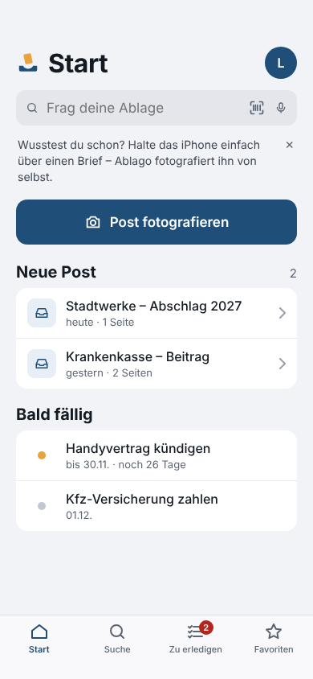</a> <a href="ios/1b.png">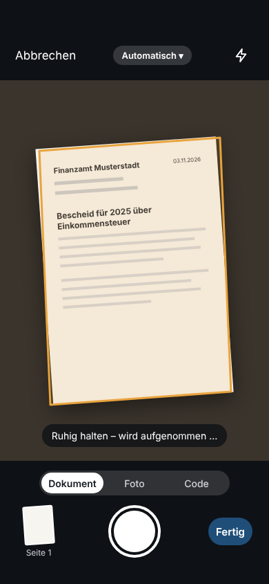</a> <a href="ios/1b-2.png">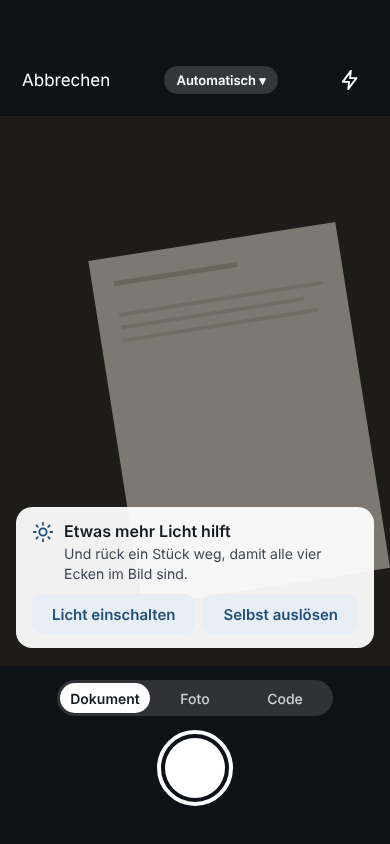</a> <a href="ios/1c.png">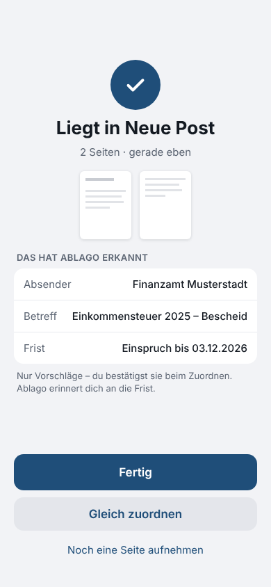</a>

**1a** Start · **1b** Brief fotografieren · **1b′** Schwierige Aufnahme: ruhiger Hinweis · **1c** Liegt in Neue Post

### 2 · Anhang aus einer anderen App teilen

**Personas:** Lena ●, Markus ●, Herr Özdemir ●, Katrin ●, Brandt ● · **Version:** V1

- **Situation:** Eine Rechnung kommt per Mail aufs Handy.
- **Erwartung:** Teilen → Ablago → fertig, statt vieler Schritte im Browser.
- **Lösung:**
  - Ablago als Ziel im Teilen-Blatt des Systems.
  - Kurze Bestätigung, danach ist man wieder in der Ursprungs-App.

**Entwürfe iOS:**

<a href="ios/2a.png">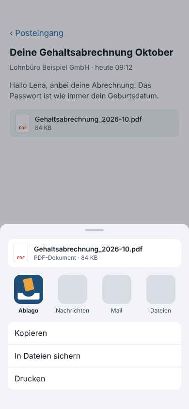</a> <a href="ios/2b.png">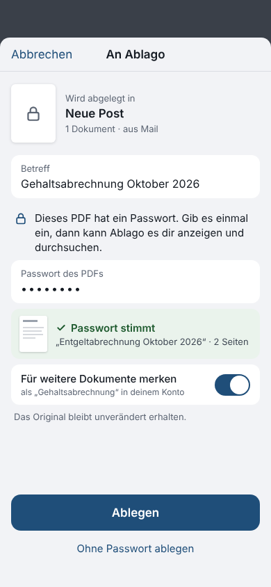</a> <a href="ios/2c.png">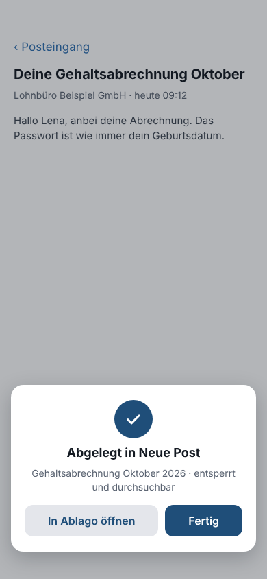</a>

**2a** Teilen aus der Mail · **2b** An Ablago, mit Passwort · **2c** Abgelegt

### 3 · Passwortgeschütztes PDF teilen

**Personas:** Lena ●, Petra ● · **Version:** V1

- **Situation:** Die Gehaltsabrechnung kommt als PDF mit Passwort.
- **Erwartung:** Einmal das Passwort eingeben, danach ist das Dokument durchsuchbar.
- **Lösung:**
  - Die App prüft das Passwort sofort („Passwort stimmt“, Vorschau) und bietet „Für weitere Dokumente merken“ an.
  - Gemerkte Passwörter liegen verschlüsselt im Konto der Person (Mein Konto → Sicherheit → Passwörter für Dokumente), Standard aus; Ansehen und Ändern nur nach erneuter Anmeldung; ausdrücklich keine Passwortverwaltung.
  - Ist das Passwort gemerkt, legt Ablago direkt ab und sagt das (2c′).

**Entwürfe iOS:**

 <a href="ios/2c-2.png">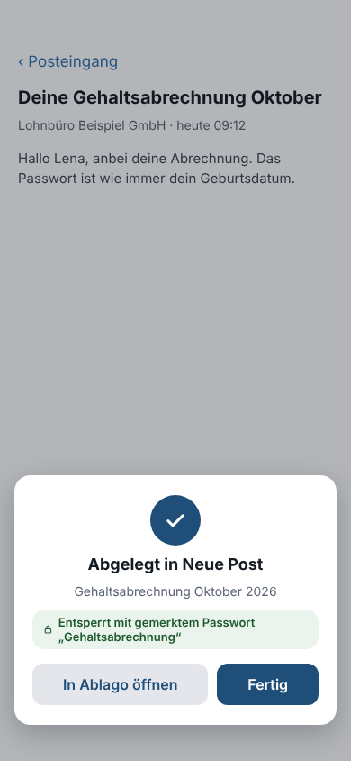</a> <a href="ios/2d.png">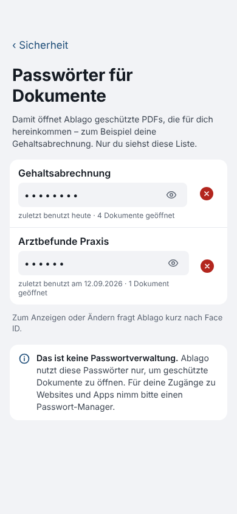</a>

**2b** An Ablago, mit Passwort · **2c′** Passwort war gemerkt – direkt abgelegt · **2d** Mein Konto – Passwörter für Dokumente

### 4 · E-Rechnung aus der Mail

**Personas:** Katrin ●, Brandt ● · **Version:** V2

- **Situation:** Katrin bekommt eine E-Rechnung (ZUGFeRD/XRechnung).
- **Erwartung:** Teilen, und Ablago kennt Absender, Betrag und Zahlungsziel.
- **Lösung:**
  - Angaben kommen aus der Rechnung selbst („selbst gelesen“), Ziel-Ablage wird vorgeschlagen.
  - Es entsteht gleich die Aufgabe „Bezahlen bis …“.
  - Ansicht **Lesbar | Original**; das Original bleibt unverändert. Kein Versprechen einer Zertifizierung.

**Entwürfe iOS:**

<a href="ios/18a.png">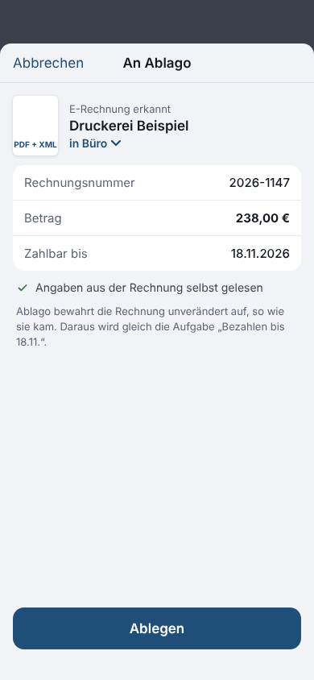</a> <a href="ios/18b.png">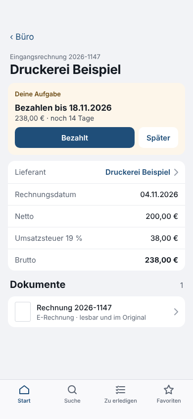</a> <a href="ios/18c.png">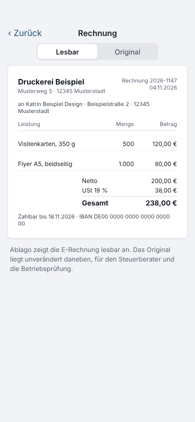</a>

**18a** E-Rechnung aus der Mail teilen · **18b** Mappe Eingangsrechnung mit Aufgabe · **18c** Lesbar | Original

### 5 · Beleg unterwegs (Bewirtung)

**Personas:** Katrin ●, Brandt ● · **Version:** V2

- **Situation:** Katrin hat einen Kunden zum Essen eingeladen.
- **Erwartung:** Beleg fotografieren und gleich ergänzen, was das Finanzamt verlangt.
- **Lösung:**
  - Nach dem Fotografieren: „Sieht nach einer Bewirtung aus“ (gleiches Muster wie „Sieht nach einem Kauf aus“, 10a).
  - Anlass, Gäste, wer bewirtet hat, Trinkgeld; Wo/Wann/Betrag vom Beleg.
  - „Das war privat“ legt den Beleg in die andere Ablage. „Später“ erzeugt eine Aufgabe in „Zu erledigen“.

**Entwürfe iOS:**

<a href="ios/19a.png">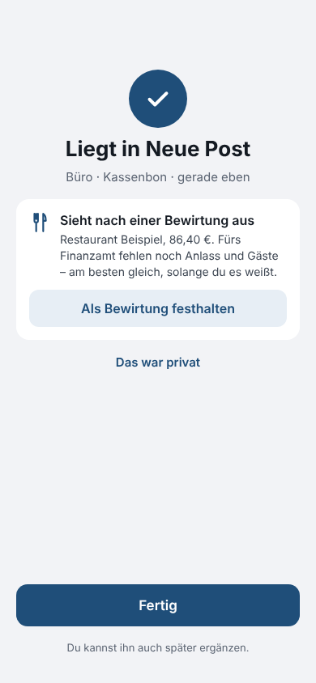</a> <a href="ios/19b.png">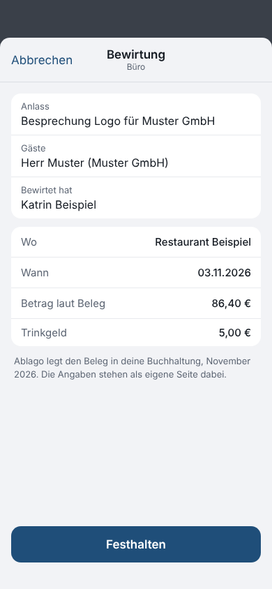</a>

**19a** Beleg fotografiert: Bewirtung erkannt · **19b** Anlass und Gäste ergänzen

### 6 · Fotos direkt an eine Mappe

**Personas:** Herr Özdemir ●, Brandt ●, Lena ○ · **Version:** V2

- **Situation:** Lena hat einen Wasserschaden für die Versicherung.
- **Erwartung:** Mappe öffnen, Fotos machen, sie liegen genau dort.
- **Lösung:**
  - Im Register „Dokumente“ unten die Zeile „+ Hinzufügen · Foto, Brief oder Datei“.
  - Kamera im Modus „Foto“, das Ziel steht oben („in: Hausratversicherung“); keine Zuordnung nötig.
  - Mehrere Fotos auf Wunsch „als ein Dokument“.
  - Auch aus der Notiz erreichbar („Foto oder Brief dazu?“, 11a) – Notiz und Dokument bleiben getrennt.

**Entwürfe iOS:**

<a href="ios/14a.png">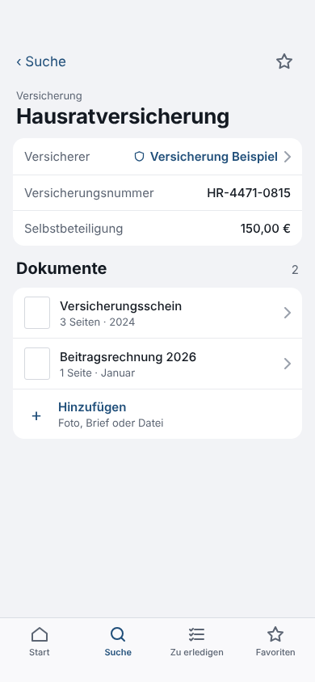</a> <a href="ios/14b.png">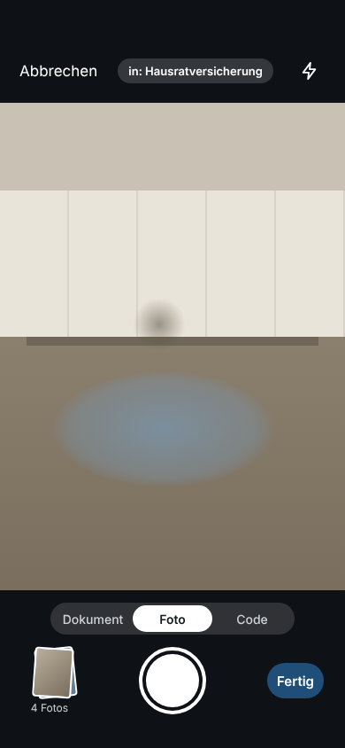</a> <a href="ios/14c.png">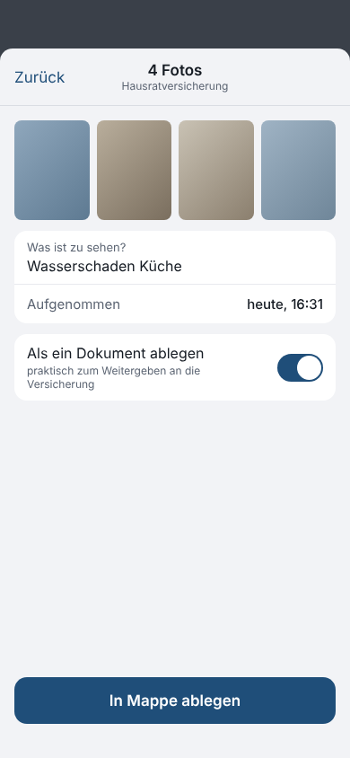</a> <a href="ios/14d.png">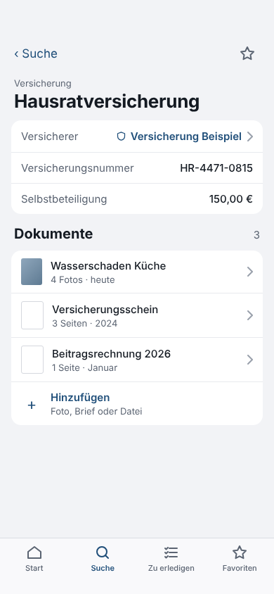</a>

**14a** Mappe Hausratversicherung: „+ Hinzufügen“ · **14b** Kamera im Modus „Foto“, Ziel steht oben · **14c** 4 Fotos ablegen · **14d** Liegt in der Mappe

### 7 · Angabe nachschlagen

**Personas:** alle ● · **Version:** V1

- **Situation:** In der Werkstatt wird nach der Fahrgestellnummer gefragt.
- **Erwartung:** In Sekunden da, ohne PDF zu öffnen.
- **Lösung:**
  - Suchfeld oben (gleich auf Start und Suche), Favoriten mit Stern, Diktieren.
  - Die Mappe zeigt zuerst die **Felder**; Verweise (z. B. Händler) mit Akzentfarbe, Typsymbol und ›.

**Entwürfe iOS:**

<a href="ios/3a.png">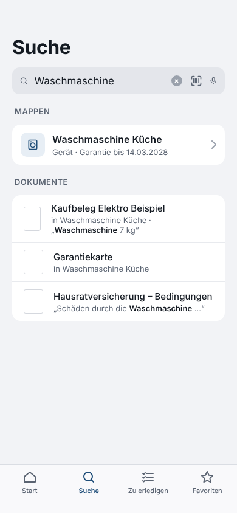</a> <a href="ios/3b.png">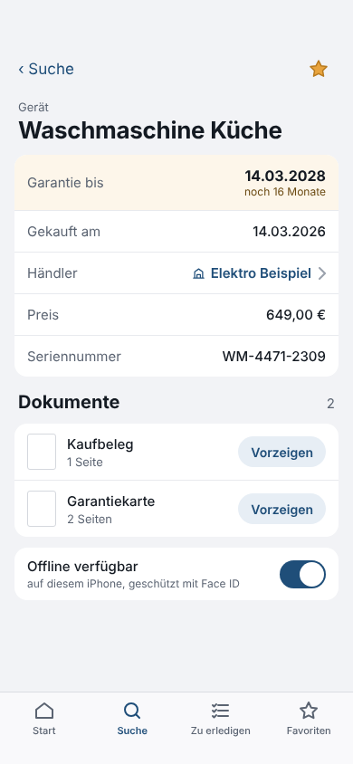</a> <a href="ios/3d.png">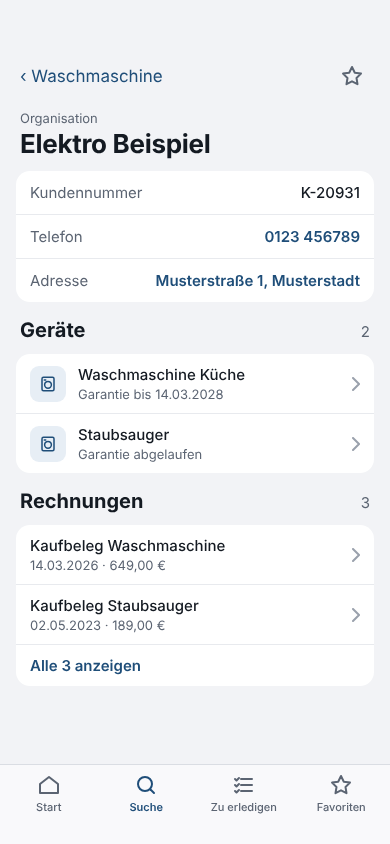</a>

**3a** Suche „Waschmaschine“ · **3b** Mappe mit Feldern zuerst · **3d** Verweis: Händler „Elektro Beispiel“

### 8 · Dokument vorzeigen

**Personas:** Lena ●, Jonas ●, Petra ● · **Version:** V1

- **Situation:** Beim Arzt oder in der Werkstatt.
- **Erwartung:** Vollbild, gut lesbar, ohne Gefummel.
- **Lösung:**
  - Vorzeigen: hell, Bildschirm bleibt an, Zoom mit zwei Fingern.
  - Geht auch offline (12d).

**Entwürfe iOS:**

<a href="ios/3c.png">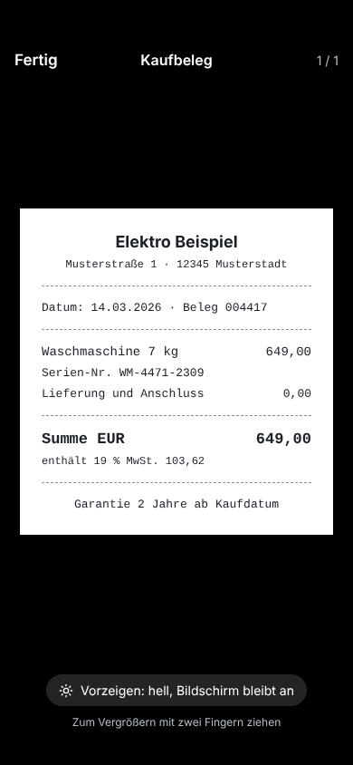</a> <a href="ios/3e.png">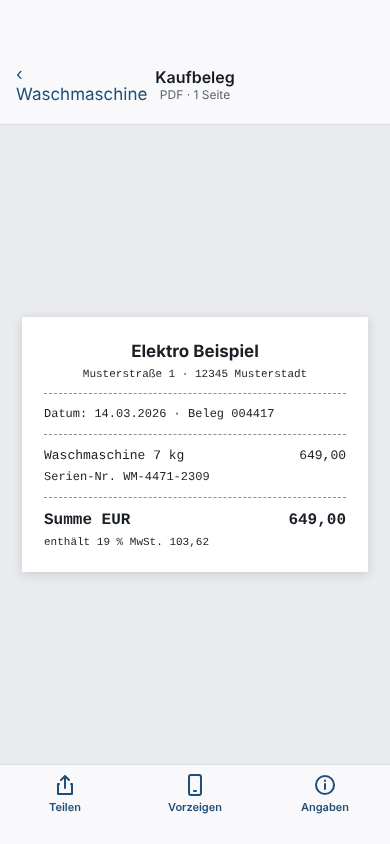</a> <a href="ios/12d.png">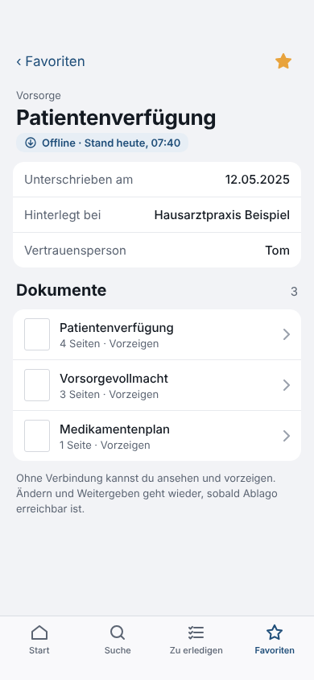</a>

**3c** Beleg vorzeigen · **3e** Dokument ansehen · **12d** Mappe offline: ansehen und vorzeigen

### 9 · Notfall und Reise: Mappen offline dabei

**Personas:** Lena ●, Petra ● · **Version:** V1

- **Situation:** Ohne Netz im Krankenhaus oder im Ausland.
- **Erwartung:** Die wichtigsten Mappen gehen immer.
- **Lösung:**
  - Bewusste Entscheidung beim Einrichten: Schalter **„Favoriten offline dabei“** (Standard aus); der Text darunter passt sich dem Schalter an (9c/9c′).
  - Danach genügt der Stern – kein Hinweis in der Mappe.
  - Offline überall dieselbe ruhige Plakette „Offline · Stand …“.
  - Öffnen nur mit Face ID; ansehen und vorzeigen ja, ändern und weitergeben erst wieder mit Verbindung.
  - Einstellung unter „Auf diesem iPhone → Offline dabei“; gilt für alle Ablagen des Geräts, bei mehreren Ablagen einzeln abschaltbar (17e).
  - Verlust des Geräts: im Browser abmelden, Ablago löscht die Offline-Mappen beim nächsten Kontakt; Hinweis auf den Notfallpass der Health-App.

**Entwürfe iOS:**

<a href="ios/9c.png">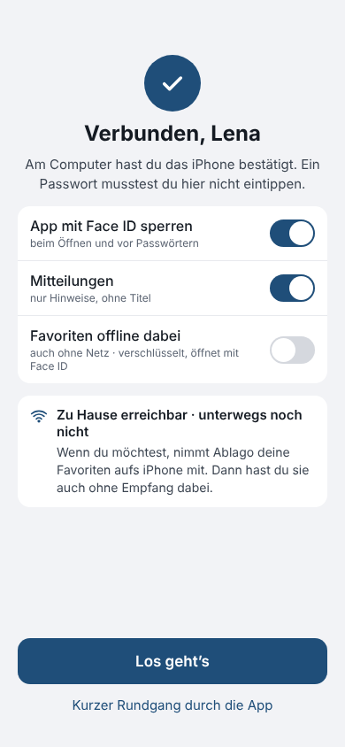</a> <a href="ios/9c-2.png">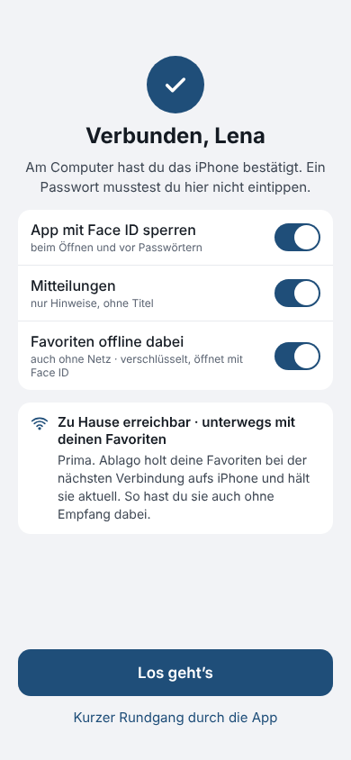</a> <a href="ios/12a.png">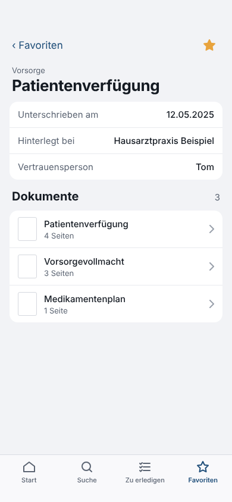</a> <a href="ios/12b.png">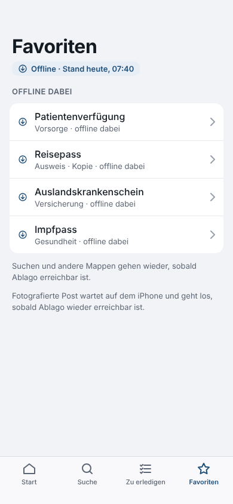</a> <a href="ios/12c.png">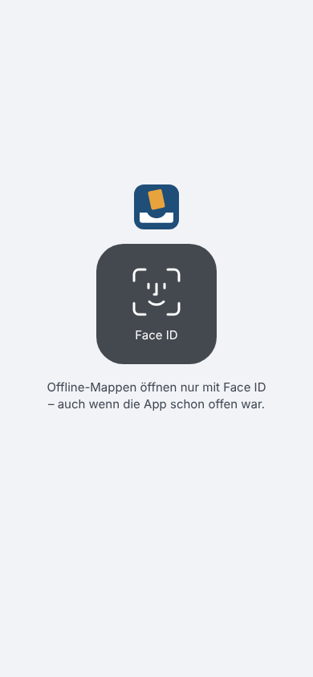</a>  <a href="ios/12e.png">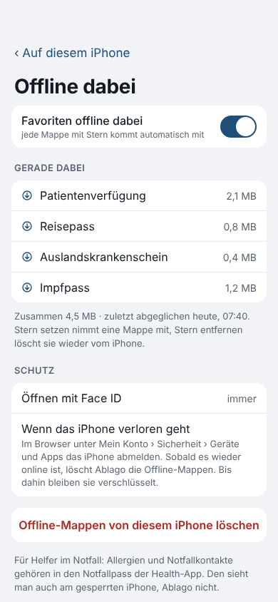</a> <a href="ios/17e.png">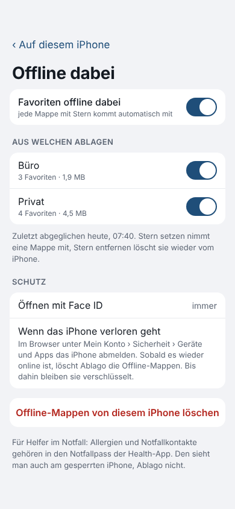</a>

**9c** Verbunden: „Favoriten offline dabei“ aus · **9c′** … und eingeschaltet: Text wechselt · **12a** Stern setzen – sonst nichts · **12b** Unterwegs ohne Netz: Favoriten · **12c** Öffnen nur mit Face ID · **12d** Mappe offline: ansehen und vorzeigen · **12e** Auf diesem iPhone › Offline dabei: „Favoriten offline dabei“ · **17e** Offline dabei bei mehreren Ablagen

### 10 · Im Laden: Kaufbeleg und Garantie

**Personas:** Lena ● · **Version:** V2

- **Situation:** Die Waschmaschine ist kaputt.
- **Erwartung:** „Waschmaschine“ suchen, Kaufbeleg und Garantie sind da.
- **Lösung:**
  - Beim Fotografieren eines Kassenbons: „Sieht nach einem Kauf aus – als Gerät mit Garantie festhalten?“
  - Formular „Neues Gerät“ mit Garantie bis; der Abschnitt „Ablago erinnert dich“ zeigt die Erinnerungen der Automatisierungen statt eines eigenen Schalters.

**Entwürfe iOS:**

<a href="ios/10a.png">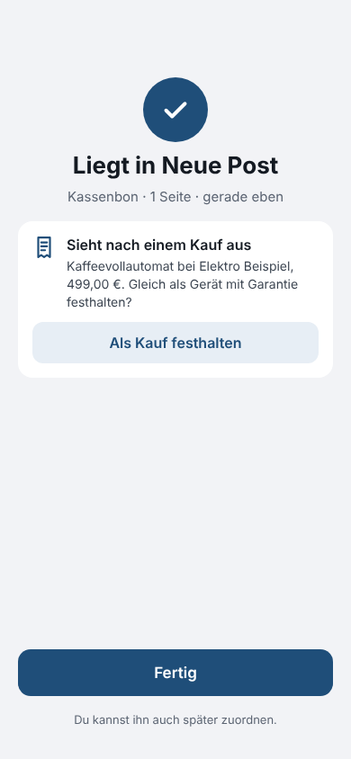</a> <a href="ios/10b.png">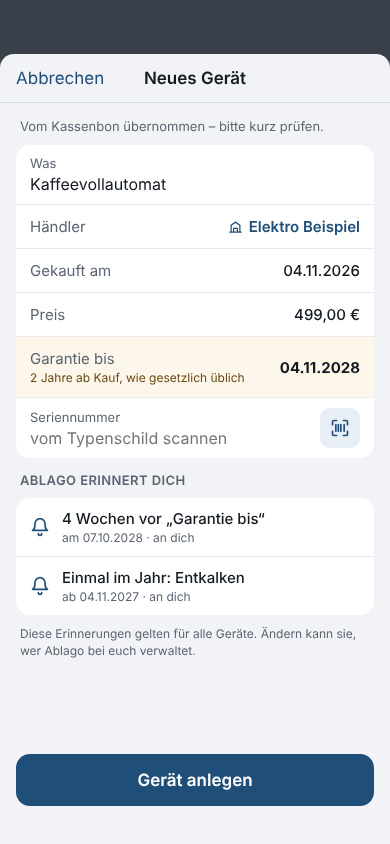</a>  

**10a** Kassenbon erkannt · **10b** Kauf festhalten mit Garantie · **3a** Suche „Waschmaschine“ · **3b** Mappe mit Feldern zuerst

### 11 · Mitteilung bei Frist oder Aufgabe

**Personas:** alle ● · **Version:** V1

- **Situation:** Die Kündigungsfrist läuft ab.
- **Erwartung:** Eine Mitteilung; Antippen führt direkt zur Sache.
- **Lösung:**
  - Standard „Nur Hinweise“ ohne Inhalt; „Mit Titeln“ ist eine bewusste Wahl („Was Ablago außerhalb der App zeigt“, gilt für Mitteilungen, Kalender und Widget zugleich).
  - Antippen öffnet die Mappe mit dem Kasten **„Deine Aufgabe“**: Erledigt · Weitergeben · Später, „+ Notiz dazu“.

**Entwürfe iOS:**

<a href="ios/5a.png">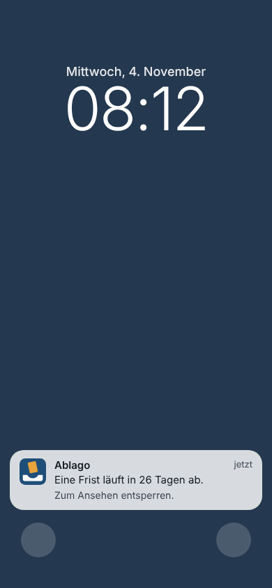</a> <a href="ios/5a-2.png">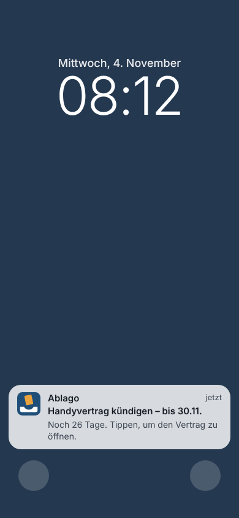</a> <a href="ios/5e.png">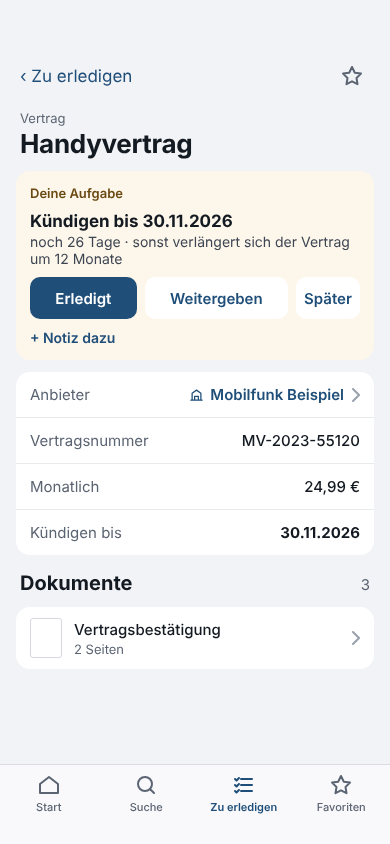</a> <a href="ios/5d.png">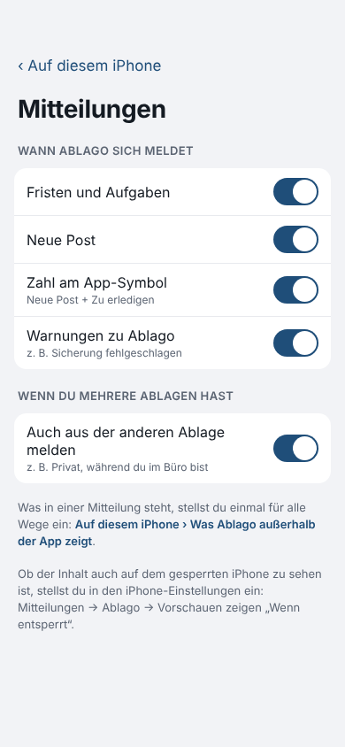</a>

**5a** Mitteilung: Frist läuft ab · **5a′** Mitteilung „Mit Titeln“ · **5e** Nach dem Antippen: Mappe mit „Deine Aufgabe“ · **5d** Auf diesem iPhone › Mitteilungen (auch aus der anderen Ablage)

### 12 · Fristen im Kalender des Handys

**Personas:** Lena ●, Petra ●, Herr Özdemir ●, Katrin ● · **Version:** V1.1

- **Situation:** Lena plant mit dem iPhone-Kalender.
- **Erwartung:** Fristen stehen dort einfach drin.
- **Lösung:**
  - Eigener Kalender „Ablago“ auf dem Gerät (kein Kalender-Abo per Link).
  - Inhalt folgt „Was Ablago außerhalb der App zeigt“.

**Entwürfe iOS:**

<a href="ios/6a.png">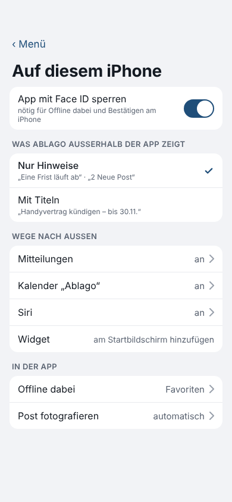</a> <a href="ios/6b.png">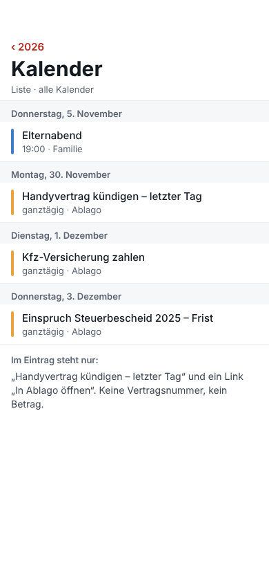</a>

**6a** Auf diesem iPhone (alle Einstellungen des Geräts) · **6b** Kalender mit Fristen

### 13 · Zu erledigen abarbeiten, zuordnen, weitergeben

**Personas:** Lena ●, Petra ●, Herr Özdemir ●, Katrin ●, Brandt ● · **Version:** V1

- **Situation:** Abends auf dem Sofa; Petra teilt Aufgaben mit ihren Brüdern.
- **Erwartung:** Zuordnen, erledigen, weitergeben.
- **Lösung:**
  - Liste „Zu erledigen“, Post zuordnen mit einfacher Mappenauswahl.
  - Weitergeben immer über den Kasten „Deine Aufgabe“ in der Mappe (5e, 22c): Person wählen, ein Satz dazu.
  - In geteilten Ablagen: „Für dich“ und „Bei Jan und Tim“.

**Entwürfe iOS:**

<a href="ios/5b.png">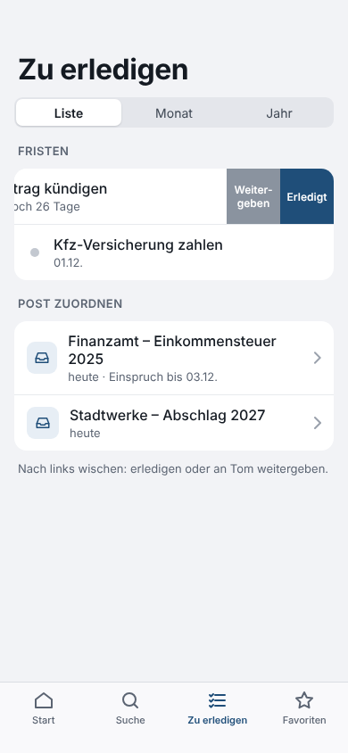</a> <a href="ios/5c.png">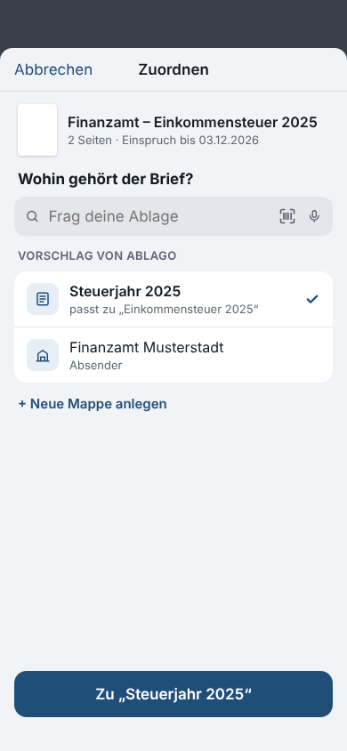</a>  <a href="ios/22b.png">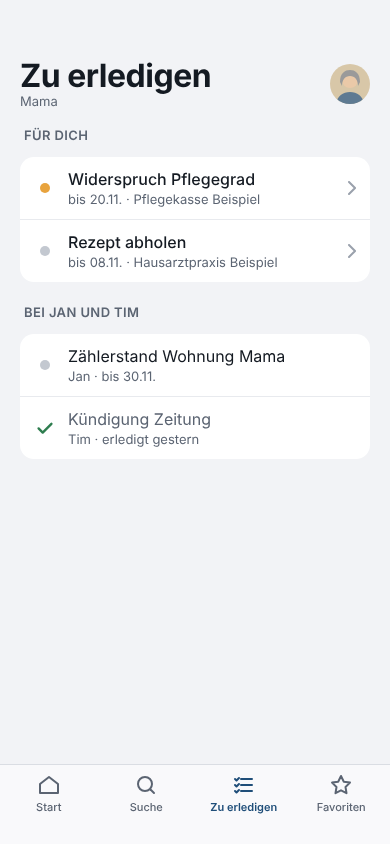</a> <a href="ios/22c.png">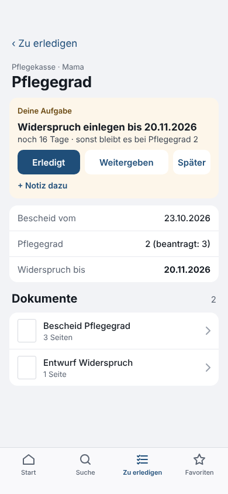</a> <a href="ios/22d.png">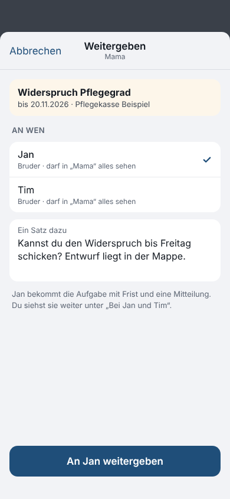</a>

**5b** Zu erledigen · **5c** Post zuordnen · **5e** Nach dem Antippen: Mappe mit „Deine Aufgabe“ · **22b** Zu erledigen in „Mama“: für dich, bei Jan und Tim · **22c** Mappe mit „Deine Aufgabe“ → Weitergeben (wie 5e) · **22d** Aufgabe an Jan weitergeben

### 14 · Widget auf dem Startbildschirm

**Personas:** Lena ●, Markus ●, Katrin ● · **Version:** V1.1

- **Situation:** Auf einen Blick, ohne die App zu öffnen.
- **Erwartung:** „2 Neue Post · 1 Zu erledigen“.
- **Lösung:**
  - Zahlen aus dem Zähler-Endpunkt; Zahl am App-Symbol = Neue Post + Zu erledigen.
  - Mit zwei Ablagen beide als Zeilen untereinander (21a).

**Entwürfe iOS:**

<a href="ios/7a.png">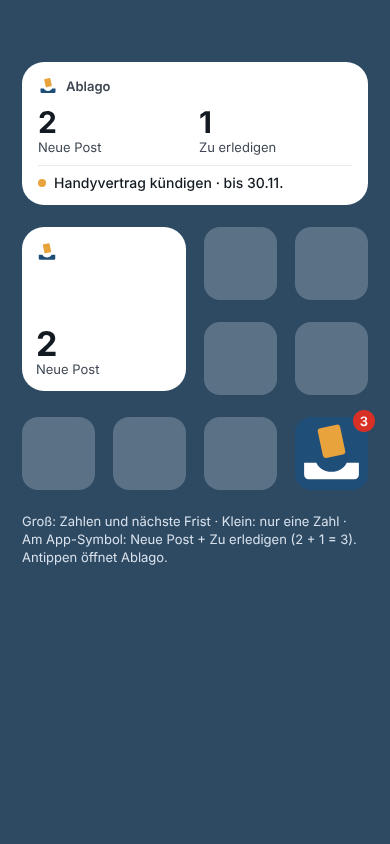</a> <a href="ios/21a.png">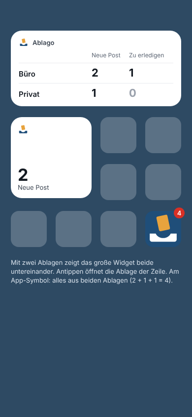</a>

**7a** Widget auf dem Startbildschirm · **21a** Widget mit zwei Ablagen

### 15 · Warnung: Sicherung, Speicher, Update

**Personas:** Lena ●, Markus ●, Brandt ● · **Version:** V1.1

- **Situation:** Die Sicherung ist seit drei Tagen fehlgeschlagen.
- **Erwartung:** Wer verwaltet, erfährt es sofort.
- **Lösung:**
  - Echte Warnung mit rotem Rand, beruhigender Text, zwei Schritte, „Jetzt sichern“; alles Weitere im Browser.

**Entwürfe iOS:**

<a href="ios/8a.png">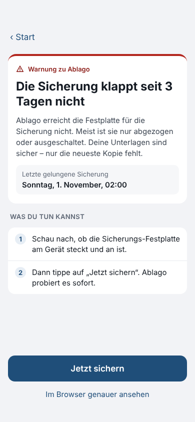</a>

**8a** Warnung: Sicherung klappt nicht

### 16 · Alarm: Notfallzugang benutzt, neue Anmeldung

**Personas:** Lena ●, Markus ●, Brandt ● · **Version:** V1.1

- **Situation:** Jemand hat den Notfallzugang benutzt.
- **Erwartung:** Sofort Bescheid wissen und reagieren.
- **Lösung:**
  - Wann, von wo, welches Gerät; „Das war ich – in Ordnung“ und „Das war ich nicht – Zugang sperren“.

**Entwürfe iOS:**

<a href="ios/8b.png">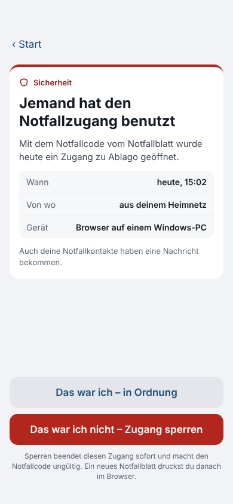</a>

**8b** Alarm: Notfallzugang benutzt

### 17 · Verwalten am Computer, am iPhone bestätigen

**Personas:** Markus ●, Brandt ●, Lena ○ · **Version:** V2

- **Situation:** Lena wählt im Browser „Ablago verwalten“.
- **Erwartung:** Das Handy fragt „Bist du das?“, Face ID, fertig.
- **Lösung:**
  - Der Browser zeigt eine Zahl; am iPhone wird die Zahl **gewählt** (nicht nur verglichen), dann Face ID.
  - Nur möglich, solange die App mit Face ID gesperrt ist; sonst wie gewohnt Passwort. „Stattdessen mit Passwort bestätigen“ bleibt immer.
  - „Das war ich nicht“ führt zum Alarm (8b).

**Entwürfe iOS:**

<a href="ios/15a.png">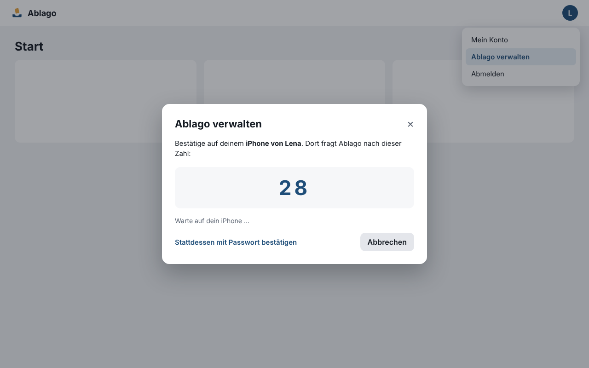</a> <a href="ios/15b.png">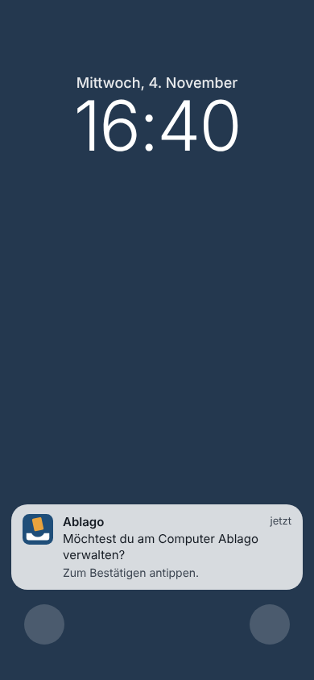</a> 

**15a** Im Browser: „Ablago verwalten“ – Bestätigung am iPhone · **15b** Mitteilung am iPhone · **15c** Zahl wählen, mit Face ID bestätigen

### 18 · Zählerstand eintragen

**Personas:** Herr Özdemir ●, Lena ○ · **Version:** V2

- **Situation:** Lena oder Herr Özdemir lesen einen Zähler ab.
- **Erwartung:** Erinnert werden, Stand eintragen, fertig.
- **Lösung:**
  - Einfach gehalten: normaler Mappentyp „Zähler“ mit Feld „Zählerstand“, von Hand eingetragen; die Erinnerung führt zur Mappe mit „Deine Aufgabe“ (erledigen oder weitergeben).
  - Zweiter Weg: Code am Zähler scannen → direkt zur Mappe.
  - Bewusst noch nicht: Stand auf dem Foto erkennen, Messreihen, Mappen aus Aufgaben anlegen.

**Entwürfe iOS:**

  

**16a** Mappe „Stromzähler“ mit Aufgabe (aus der Erinnerung) · **16b** Stand von Hand eintragen, Aufgabe erledigt · **16c** Oder: Code am Zähler scannen → direkt zur Mappe

### 19 · Notiz an eine Mappe

**Personas:** Brandt ●, alle ○ · **Version:** V2

- **Situation:** Kündigung per Mail geschickt, Bestätigung soll per Post kommen.
- **Erwartung:** Kurz festhalten, was passiert ist.
- **Lösung:**
  - Großes Textfeld, Diktieren.
  - „Ablago erinnert dich schon“ zeigt die vorhandenen Erinnerungen; kein eigener Erinnerungsschalter.
  - Schalter „Aufgabe … erledigt“; Fotos gehören als Dokument in die Mappe, nicht in die Notiz.

**Entwürfe iOS:**

**11a** Notiz an die Mappe

### 20 · Fragen per Siri

**Personas:** Lena ●, Markus ● · **Version:** später

- **Situation:** „Frag Ablago, wann der Handyvertrag endet.“
- **Erwartung:** Eine kurze Antwort, Antippen öffnet die Mappe.
- **Lösung:**
  - Antwort nur bei entsperrtem iPhone (Standard).
  - Eigene Einstellung „Siri“ unter „Auf diesem iPhone“.

**Entwürfe iOS:**

  

**13a** Siri fragt Ablago · **13b** Gesperrtes iPhone: erst entsperren · **13c** Auf diesem iPhone › Siri

### 21 · Dokument mit Stempel weitergeben

**Personas:** Katrin ●, Petra ○ · **Version:** V2

- **Situation:** Katrin schickt einen Beleg an die Versicherung.
- **Erwartung:** Einzelnes Dokument, auf Wunsch oder Pflicht mit Stempel.
- **Lösung:**
  - Ansehen ist kein Herausgeben, Teilen schon; mit Pflicht-Stempel wird jeder Abruf vermerkt.
  - Optionaler Stempel über „Optionen“ im Teilen-Blatt.
  - Vermerkt wird erst, wenn wirklich gesendet wurde.
  - **Abgrenzung:** viele Dokumente auf einmal (z. B. alle Belege eines Monats an den Steuerberater) macht der Browser, nicht die App.

**Entwürfe iOS:**

   

**3e** Dokument ansehen · **3f** Teilen per Mail · **3g** Optionen: Stempel wählen · **3f′** Teilen mit Pflicht-Stempel

### 22 · Mehrere Ablagen in einer App

**Personas:** Katrin ●, Petra ●, Markus ● · **Version:** V1 (Grundlage)

- **Situation:** Katrin hat Büro und Privat, Petra ihre eigene Ablage und die ihrer Mutter.
- **Erwartung:** Bewusst in einer Ablage arbeiten und trotzdem nichts verpassen.
- **Lösung:**
  - Immer genau **eine** Ablage aktiv, kein „Alles zusammen“. Der Name steht klein unter dem Titel.
  - Wechsel nur über das **Benutzerbild** (Benutzermenü). Das Bild kommt aus der Ablage und kann je Ablage verschieden sein.
  - Neues in einer anderen Ablage: kleine Zahl am Bild, dieselbe Zahl im Menü bei der Ablage, nach dem Wechsel ist der Eintrag markiert („Darum stand die Zahl an deinem Bild“).
  - Mitteilungen: Schalter „Auch aus der anderen Ablage melden“.

**Entwürfe iOS:**

    

**17a** Katrin in „Büro“ – Zahl am Bild: Neues in Privat · **17b** Benutzermenü: Ablage wechseln (Zahl bei Privat) · **17c** Mein Konto: Bild gilt in ganz Ablago · **17d** Gewechselt: „Darum die Zahl an deinem Bild“ · **22a** Petra: Ablage „Mama“ mit Zahl

### 23 · Erster Start und App verbinden

**Personas:** alle ● · **Version:** V1

- **Situation:** Lena installiert die App.
- **Erwartung:** Verbinden ohne Adresse und Passwort abzutippen.
- **Lösung:**
  - Im Browser: Mein Konto → Sicherheit → Geräte und Apps → „App verbinden“. QR-Code mit Einmal-Code und Adresse, **ohne Passwort**, gültig nur solange das Fenster offen ist (höchstens 5 Minuten, einmal).
  - Zahlenabgleich zwischen Browser und App, dann „Ja, verbinden“.
  - Danach drei Schalter: Face ID, Mitteilungen (nur Hinweise), Favoriten offline dabei; Hinweis zur Erreichbarkeit; Angebot für den Rundgang.

**Entwürfe iOS:**

    

**9a** Erster Start: Willkommen · **9b** QR-Code scannen, Zahl vergleichen · **9b′** Im Browser: App verbinden mit Zahlenabgleich · **9c** Verbunden: „Favoriten offline dabei“ aus · **9c′** … und eingeschaltet: Text wechselt

### 24 · Code scannen

**Personas:** alle ○ · **Version:** V1

- **Situation:** Seriennummer vom Typenschild, Barcode am Zähler.
- **Erwartung:** Scannen und direkt in der richtigen Mappe landen.
- **Lösung:**
  - Symbol im Suchfeld öffnet die Kamera im Modus „Code“.
  - Fundstelle wird gezeigt, „Mappe öffnen“.

**Entwürfe iOS:**

 

**4a** Code scannen (Typenschild) · **16c** Oder: Code am Zähler scannen → direkt zur Mappe

## Querschnitt: Benutzermenü und Einstellungen

Eine einzige Tür: das **Benutzerbild** oben rechts.

- **Benutzermenü:** Mein Konto (Bild, Name, Sicherheit) · Ablage wechseln (nur bei mehreren) · Auf diesem iPhone · Ablago entdecken (Tipps, Rundgang) · Weitere Ablage verbinden · Abmelden.
- **Mein Konto** gilt in ganz Ablago (auf dem Server, je Ablage). Kommt das Konto aus einer externen Benutzerverwaltung, sind Bild und Name gesperrt und das steht dabei.
- **Auf diesem iPhone** gilt nur für das Gerät, für alle Ablagen zugleich.

| Wo | Einstellung | Entwurf |
|---|---|---|
| Mein Konto | Bild, Name | 17c |
| | Passwörter für Dokumente | 2d |
| | Geräte und Apps | 17c, 9b′ |
| Benutzermenü | Ablage wechseln, weitere verbinden | 17b, 22a |
| | Ablago entdecken | 17b |
| Auf diesem iPhone | App mit Face ID sperren | 6a, 9c |
| | Was Ablago außerhalb der App zeigt | 6a |
| | Mitteilungen (auch aus der anderen Ablage) | 5d |
| | Kalender „Ablago“ | 6b |
| | Siri | 13c |
| | Widget (am Startbildschirm hinzufügen) | 6a |
| | Offline dabei | 12e, 17e |
| | Post fotografieren: automatisch auslösen | 6a |

   

**17b** Benutzermenü: Ablage wechseln (Zahl bei Privat) · **17c** Mein Konto: Bild gilt in ganz Ablago · **6a** Auf diesem iPhone (alle Einstellungen des Geräts) · **5d** Auf diesem iPhone › Mitteilungen (auch aus der anderen Ablage)

**iPad:** Seitenleiste statt Tab-Leiste, Liste und Mappe nebeneinander.

**22e** iPad: Favoriten der Ablage „Mama“

## Abgrenzung: was die App nicht macht

- **Die App macht:** Post erfassen, nachschlagen, vorzeigen, erledigen, **einzelne** Dokumente weitergeben, kurze Formulare (Kauf, Bewirtung, Zählerstand, Notiz).
- **Dafür gibt es den Browser:** Auswertungen und Summen, Sammel-Weitergabe vieler Dokumente (z. B. Monatsbelege an den Steuerberater), Protokolle erstellen, Ablago einrichten und verwalten.

## Muster, die in allen Clients gleich sind

- **Eine Tür** für Konto, Ablage und Einstellungen: das Benutzerbild.
- **Ein Zustand, eine Darstellung:** Offline überall als dieselbe ruhige Plakette.
- **Ein erklärender Text folgt dem Schalter** darüber.
- **Eine Zahl am Bild führt zu ihrem Grund** („Darum stand die Zahl an deinem Bild“).
- **Eine Mitteilung zu einer Sache führt direkt zu dieser Sache**, in die Mappe mit „Deine Aufgabe“.
- **Weitergeben zählt erst, wenn es wirklich passiert ist.**
- **„Was darf raus“ getrennt von „welcher Weg“:** eine Einstellung für Inhalte außerhalb der App, die Wege selbst nur an/aus.
- **Verweisfelder** mit Akzentfarbe, Typsymbol und ›; **Register** als Abschnitte mit Anzahl; **Hauptknopf unten**; **ruhige Fehlermeldungen**.
- **Ablago spricht von sich in der dritten Person** („Ablago erinnert dich“), Du-Form.

## Plattform-Gewohnheiten

Gleich überall: Begriffe aus dem Glossar, Du-Form, Inhalte und Bedeutung, Logo und Farben, Ruhe. Wie die Plattform: Navigation, Gesten, Zurück, Bedienelemente, Ort der Einstellungen, Systemsymbole, Schriftgrößen, Mitteilungen, Teilen, Anmeldung mit Bordmitteln (Face ID, Fingerabdruck). Wir übertragen kein Bedienkonzept einer Plattform auf eine andere.

## Bewusst offen

- Zahl am App-Symbol bei mehreren Ablagen: alles zusammen oder nur, was „Auch aus der anderen Ablage melden“ erlaubt.
- Zählerstände: Stand auf dem Foto erkennen, Messreihen, Mappen aus Aufgaben anlegen.
- Mitteilungen ohne eigenen Dienst und Erreichbarkeit von unterwegs (wird gesondert geprüft).
- Entwürfe für Android.
