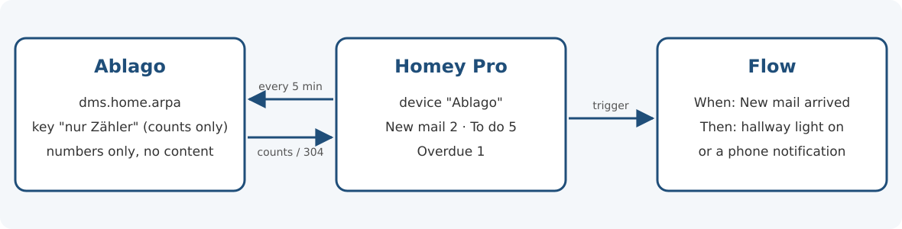
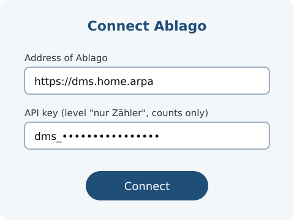

# Ablago for Homey Pro

[Deutsch](README.md) · **English**

App for **Homey Pro**: new mail, to-dos and overdue items from [Ablago](https://github.com/motom001/dms), your self-hosted document filing, as device values and Flow cards. For example, a light can turn on when new mail has arrived, or you get a notification when there is a new to-do – without anyone opening Ablago.

Ablago itself is in German, so this page names its menus and key levels in German in quotation marks, with a translation in brackets.



## Requirements

- **Homey Pro** with Homey version 12.4.0 or newer. **Homey Cloud does not work:** it runs on the internet and cannot reach Ablago on your home network.
- **Ablago version 0.148.0 or newer** (counts endpoint, [motom001/dms#625](https://github.com/motom001/dms/issues/625)).
- Homey must reach Ablago on your home network, e.g. at `https://dms.home.arpa` or `http://192.0.2.10:8080`.

## Which key? Level "nur Zähler" (counts only)

The app needs an **API key with the level "nur Zähler"** (counts only). Create it in Ablago: **click your name at the top right → "Mein Konto" (my account) → "Sicherheit" (security) → "API-Schlüssel" (API keys)**.

- **Why this level:** a "nur Zähler" key can only call `GET /api/v1/ich/zaehler` and only gets numbers there – no titles, senders, names or documents. Ablago answers everything else with `403`. If the key gets lost (for example with a Homey backup), someone learns at most how much mail and how many tasks you have.
- **"nur lesen"** (read only) works too; the device then shows a hint that "nur Zähler" is enough.
- **"lesen und schreiben"** (read and write) is rejected by the app. It does not need write access.
- The numbers belong to the **user of the key**, within their permissions. If several people should see their own numbers, each person creates their own "nur Zähler" key; in Homey, that becomes one "Ablago" device per person.

## Setup

1. Sign in to Ablago as the person whose numbers Homey should show, and under "Mein Konto" → "Sicherheit" → "API-Schlüssel" create a key with the level **"nur Zähler"**, e.g. "Homey". Copy the key right away – it is shown in full only once.
2. In the Homey app, choose **Add device → Ablago**.
3. Enter the **address of Ablago** and the **API key**. Homey tests the connection right away: you only get to the next step once numbers arrive and the level is right.
4. Add the "Ablago" device and rename it if you like, e.g. "Ablago Lena".



You can change the address, key and polling interval later in the **device settings**; Homey tests the connection there before saving, too. If the key has expired, **Repair** works as well.

If you no longer need the key, delete it in Ablago under "Mein Konto" → "Sicherheit" → "API-Schlüssel"; the device then reports "The API key is invalid, deleted or expired".

## Values and Flow cards

| Device value | Number in Ablago (`GET /api/v1/ich/zaehler`) |
| --- | --- |
| **New mail** | `neuePost`: mail in the state *Neu* (new), for you or for everyone |
| **To do** | `zuErledigen`: folders with open tasks for you – including deadlines and reminders as soon as they become due with their lead time |
| **Overdue** | `ueberfaellig`: open deadlines, reminders and tasks with a date before today |

| Flow card | Type | When |
| --- | --- | --- |
| **New mail arrived** | Trigger | The number of new mail goes up. Tokens: *New mail in total*, *Newly arrived* |
| **New to-do** | Trigger | The number "To do" goes up – also when a deadline or reminder becomes due with its lead time. Tokens: *To do in total*, *Newly added* |
| **Something is overdue** | Trigger | The number "Overdue" goes up. Tokens: *Overdue in total*, *Newly overdue* |
| **There is new mail** | Condition | "New mail" is greater than 0 (can be inverted: *no* new mail) |

All three values are also available as Flow tokens and in Insights (history).

## Polling

Homey asks Ablago once per **polling interval** (default 5 minutes, adjustable from 1 minute to 1 day). The app sends the `ETag` of the last answer as `If-None-Match`. If nothing has changed, Ablago answers `304 Not Modified` **without a body** – no numbers are transferred. A trigger therefore fires at the latest one polling interval after the new mail arrived.

Nothing fires on the first poll after setup. After Homey restarts, the app compares with the last stored values: mail that arrived in the meantime fires once.

**Instant updates:** since version 0.150.0, Ablago can also report changes itself (webhook). This version of the app does not use that yet and keeps polling at a fixed interval; instant updates will come with a later version.

## Error messages

On an error the device shows "unavailable" with the reason; during setup you see the same text. As soon as a poll works again, the device becomes available again by itself.

| Message | What to do |
| --- | --- |
| **Ablago cannot be reached.** | Check the address: is Ablago running and reachable on your home network? |
| **The API key is invalid, deleted or expired.** | Create a new "nur Zähler" key in Ablago and enter it (settings or Repair). |
| **This API key has the wrong level.** | The key may write (or has an unknown level). Create a new "nur Zähler" key. |
| Homey does not trust the certificate. | Use an address with a valid certificate or, on your own home network only, the `http://` address. |
| No Ablago 0.148.0 or newer answers at this address. | Check the address and the version. |
| Ablago is in maintenance mode. | Nothing – Homey asks again on its own after the waiting time Ablago gives (at most one polling interval). |

## Privacy

- **No telemetry, no connections to third parties.** The app only talks to the Ablago address you enter. Installation and updates go through the Homey App Store; the platform requires that.
- **Numbers only:** the app only reads three numbers from Ablago (and, on start, the level of the key via `GET /api/v1/ich`; it stores nothing from there).
- **What is stored where:** address and key are kept in the device settings on your Homey Pro (the key in a password field, never displayed). Homey does not offer apps a separate keychain. Homey stores the numbers as device values and in Insights. The key never appears in the app log.

## Limits

- If, within one polling interval, as much mail arrives as is dealt with, the number stays the same – "New mail arrived" then does not fire.
- The same applies to "New to-do" and "Something is overdue": they only fire when the number goes up.
- When a deadline becomes a to-do is set by its lead time in Ablago. The app has no time window of its own (such as "within 7 days").
- The app does not follow redirects (e.g. from `http://` to `https://`), so the key never goes to another address. Enter the target address directly.

## Development

```sh
cd homey
npm ci              # only tools for checking; the app itself has no dependencies
npm test            # logic and device against a fake server (node --test)
npm run validieren  # manifest, images and Flow cards like "homey app validate --level publish"
```

- Layout: `lib/` holds the logic without the Homey runtime (polling with ETag, evaluation, error mapping), `drivers/dms/` the device and setup, `locales/` the texts (de, en). The manifest is written directly in `app.json` (without Homey Compose). Internal identifiers (`dms_…`, `drivers/dms/`) stay as they are on purpose.
- Terms, paths and icons follow the rules for all clients (see [CONTRIBUTING.en.md](../CONTRIBUTING.en.md)); the tests check them too.
- Try it on a Homey Pro: `npx homey app run` (Homey CLI, requires signing in with Athom).
- Images: sources as SVG in `bilder/`; the PNGs in `assets/images/` and `drivers/dms/assets/images/` are rendered from them (e.g. `rsvg-convert -w 1000 -h 700 bilder/app-bild.svg -o assets/images/xlarge.png`). The value icons in `assets/capabilities/` come from [Lucide](https://lucide.dev) (ISC license, see `LICENSE-lucide.txt`).
- New version: bump `version` in `package.json` and `app.json`, add to `CHANGELOG.md` and `.homeychangelog.json`. A release gets the tag `homey-v<version>` and is uploaded with `npx homey app publish`.

## License

[Apache-2.0](../LICENSE), see also [NOTICE](../NOTICE). The name and logo "Ablago" are not covered by the license.
