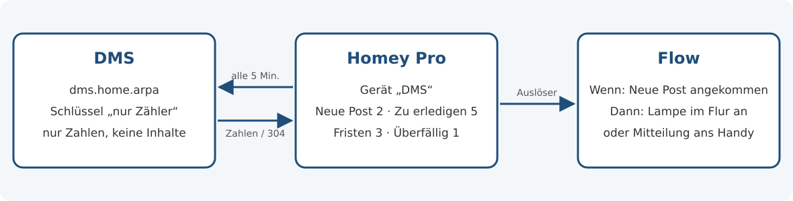
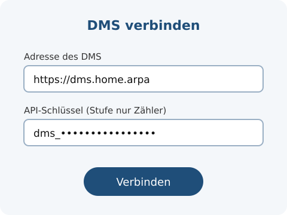

# Ablago für Homey Pro

**Deutsch** · [English](README.en.md)

App für **Homey Pro**: Neue Post, Aufgaben und Fälliges aus [Ablago](https://github.com/motom001/dms), deiner selbst gehosteten Dokumentenablage, als Werte am Gerät und als Flow-Karten. So kann zum Beispiel eine Lampe leuchten, wenn neue Post da ist, oder eine Mitteilung kommen, wenn etwas bald fällig wird – ohne dass jemand Ablago öffnet.



## Voraussetzungen

- **Homey Pro** mit Homey ab Version 12.4.0. **Homey Cloud geht nicht:** Sie läuft im Internet und erreicht Ablago in deinem Heimnetz nicht.
- **Ablago ab Version 0.148.0** (Zähler-Endpunkt, [motom001/dms#625](https://github.com/motom001/dms/issues/625)).
- Homey muss Ablago im Heimnetz erreichen, z. B. unter `https://dms.home.arpa` oder `http://192.0.2.10:8080`.

## Welcher Schlüssel? Stufe „nur Zähler“

Die App braucht einen **API-Schlüssel mit der Stufe „nur Zähler“**. Den legst du in Ablago an: **Klick oben rechts auf deinen Namen → Mein Konto → Sicherheit → API-Schlüssel**.

- **Warum diese Stufe:** Ein Schlüssel „nur Zähler“ ruft nur `GET /api/v1/ich/zaehler` auf und bekommt dort nur Zahlen – keine Titel, Absender, Namen oder Dokumente. Alles andere beantwortet Ablago mit `403`. Geht der Schlüssel verloren (etwa mit einer Sicherung des Homey), erfährt jemand höchstens, wie viel Post und Aufgaben du hast.
- **„nur lesen“** funktioniert auch; das Gerät zeigt dann den Hinweis, dass „nur Zähler“ genügt.
- **„lesen und schreiben“** lehnt die App ab. Sie braucht keine Schreibrechte.
- Die Zahlen gelten für den **Benutzer des Schlüssels** und in seinen Rechten. Sollen mehrere Personen ihre eigenen Zahlen sehen, legt jede Person ihren eigenen Schlüssel „nur Zähler“ an; in Homey wird daraus je Person ein eigenes Gerät „Ablago“.

## Einrichten

1. In Ablago als die Person anmelden, deren Zahlen Homey zeigen soll, und unter **Mein Konto → Sicherheit → API-Schlüssel** einen Schlüssel mit der Stufe **„nur Zähler“** anlegen, z. B. „Homey“. Den Schlüssel gleich kopieren – er ist nur einmal ganz zu sehen.
2. In der Homey-App **Gerät hinzufügen → Ablago** wählen.
3. **Adresse von Ablago** und **API-Schlüssel** eintragen. Homey prüft die Verbindung sofort: Erst wenn Zahlen kommen und die Stufe passt, geht es weiter.
4. Gerät „Ablago“ hinzufügen und bei Bedarf umbenennen, z. B. „Ablago Lena“.



Adresse, Schlüssel und Abfrage-Abstand änderst du später in den **Einstellungen des Geräts**; auch dort prüft Homey die Verbindung vor dem Speichern. Ist der Schlüssel abgelaufen, geht auch **Reparieren**.

Brauchst du den Schlüssel nicht mehr, löschst du ihn in Ablago unter **Mein Konto → Sicherheit → API-Schlüssel**; das Gerät meldet dann „Der API-Schlüssel ist ungültig, gelöscht oder abgelaufen“.

## Werte und Flow-Karten

| Wert am Gerät | Zahl in Ablago (`GET /api/v1/ich/zaehler`) |
| --- | --- |
| **Neue Post** | `neuePost`: Post im Stand *Neu*, für dich oder für alle |
| **Zu erledigen** | `zuErledigen`: Mappen mit offenen Aufgaben für dich |
| **Fällig in 7 Tagen** | `anstehend`: Fristen, Erinnerungen und Aufgaben mit Datum von heute bis in 7 Tagen |
| **Überfällig** | `ueberfaellig`: offene Fristen, Erinnerungen und Aufgaben mit Datum vor heute |

| Flow-Karte | Art | Wann |
| --- | --- | --- |
| **Neue Post angekommen** | Auslöser | Die Zahl der neuen Post steigt. Tokens: *Neue Post insgesamt*, *Neu dazugekommen* |
| **Etwas wird bald fällig / ist überfällig** | Auslöser | „Fällig in 7 Tagen“ bzw. „Überfällig“ steigt – auch, wenn jemand etwas Neues mit Datum in den nächsten 7 Tagen anlegt. Tokens: *Fällig in 7 Tagen*, *Überfällig* |
| **Es liegt neue Post vor** | Bedingung | „Neue Post“ ist größer als 0 (auch umkehrbar: *keine* neue Post) |

Alle vier Werte stehen außerdem als Tokens in Flows und in Insights (Verlauf) zur Verfügung.

## Abfrage

Homey fragt Ablago im **Abfrage-Abstand** (Vorgabe 5 Minuten, einstellbar von 1 Minute bis 1 Tag). Dabei schickt die App das `ETag` des letzten Abrufs als `If-None-Match`. Hat sich nichts geändert, antwortet Ablago mit `304 Not Modified` **ohne Inhalt** – es werden keine Zahlen übertragen. Ein Auslöser kommt also spätestens einen Abfrage-Abstand nach der neuen Post.

Beim ersten Abruf nach dem Einrichten löst nichts aus. Nach einem Neustart des Homey vergleicht die App mit den zuletzt gespeicherten Werten: Post, die in der Zwischenzeit kam, löst dann einmal aus.

**Sofort melden:** Ablago kann sich seit Version 0.150.0 auch selbst melden (Webhook). Diese Version der App nutzt das noch nicht und fragt weiter im festen Abstand; sofortiges Melden kommt mit einer späteren Version.

## Fehlermeldungen

Bei einem Fehler zeigt das Gerät „nicht verfügbar“ mit dem Grund; beim Einrichten erscheint derselbe Text. Sobald ein Abruf wieder klappt, ist das Gerät von selbst wieder verfügbar.

| Meldung | Was tun |
| --- | --- |
| **Ablago ist nicht erreichbar.** | Adresse prüfen: Läuft Ablago, ist es im Heimnetz erreichbar? |
| **Der API-Schlüssel ist ungültig, gelöscht oder abgelaufen.** | In Ablago einen neuen Schlüssel „nur Zähler“ anlegen und eintragen (Einstellungen oder Reparieren). |
| **Dieser API-Schlüssel hat die falsche Stufe.** | Der Schlüssel darf schreiben (oder hat eine unbekannte Stufe). Neuen Schlüssel „nur Zähler“ anlegen. |
| Homey vertraut dem Zertifikat nicht. | Adresse mit gültigem Zertifikat nehmen oder, nur im eigenen Heimnetz, die `http://`-Adresse. |
| Unter dieser Adresse antwortet kein Ablago ab 0.148.0. | Adresse und Version prüfen. |
| Ablago ist im Wartungsmodus. | Nichts – Homey fragt nach der Wartezeit, die Ablago nennt, von selbst wieder (höchstens nach einem Abfrage-Abstand). |

## Datenschutz

- **Keine Telemetrie, keine Verbindungen zu Dritten.** Die App spricht nur mit der Adresse von Ablago, die du einträgst. Installation und Updates laufen über den Homey App Store; das verlangt die Plattform.
- **Nur Zahlen:** Die App liest bei Ablago nur die vier Zahlen (und beim Start die Stufe des Schlüssels über `GET /api/v1/ich`; dort speichert sie nichts).
- **Wo was liegt:** Adresse und Schlüssel stehen in den Einstellungen des Geräts auf deinem Homey Pro (der Schlüssel in einem Passwortfeld, nicht angezeigt). Einen eigenen Schlüsselbund bietet Homey Apps nicht. Die Zahlen speichert Homey als Werte des Geräts und in Insights. Der Schlüssel steht nie im Protokoll der App.

## Grenzen

- Kommt in einem Abfrage-Abstand genauso viel Post dazu, wie erledigt wird, bleibt die Zahl gleich – dann löst „Neue Post angekommen“ nicht aus.
- „Etwas wird bald fällig“ zählt nur, ob die Zahl steigt: Rückt etwas in die nächsten 7 Tage, während etwas anderes erledigt wird, löst nichts aus.
- Die App folgt keinen Weiterleitungen (z. B. von `http://` auf `https://`), damit der Schlüssel nicht an eine andere Adresse geht. Trag die Zieladresse direkt ein.

## Entwicklung

```sh
cd homey
npm ci              # nur Werkzeuge für die Prüfung; die App selbst hat keine Abhängigkeiten
npm test            # Logik und Gerät gegen einen nachgebauten Server (node --test)
npm run validieren  # Manifest, Bilder und Flow-Karten wie „homey app validate --level publish“
```

- Aufbau: `lib/` enthält die Logik ohne Homey-Laufzeit (Abruf mit ETag, Auswertung, Fehlerzuordnung), `drivers/dms/` das Gerät und das Einrichten, `locales/` die Texte (de, en). Das Manifest steht direkt in `app.json` (ohne Homey Compose). Interne Kennungen (`dms_…`, `drivers/dms/`) bleiben bewusst so.
- Begriffe, Wege und Symbole folgen den Regeln für alle Clients (siehe [CONTRIBUTING.md](../CONTRIBUTING.md)); die Tests prüfen das mit.
- Ausprobieren auf einem Homey Pro: `npx homey app run` (Homey-CLI, Anmeldung bei Athom nötig).
- Bilder: Quellen als SVG in `bilder/`; die PNG unter `assets/images/` und `drivers/dms/assets/images/` sind daraus gerendert (z. B. `rsvg-convert -w 1000 -h 700 bilder/app-bild.svg -o assets/images/xlarge.png`). Die Symbole der Werte in `assets/capabilities/` stammen aus [Lucide](https://lucide.dev) (ISC-Lizenz, siehe `LICENSE-lucide.txt`).
- Neue Version: `version` in `package.json` und `app.json`, `CHANGELOG.md` und `.homeychangelog.json` ergänzen. Ein Release bekommt den Tag `homey-v<version>` und wird mit `npx homey app publish` hochgeladen.

## Lizenz

[Apache-2.0](../LICENSE), siehe auch [NOTICE](../NOTICE). Name und Logo „Ablago“ sind von der Lizenz nicht erfasst.
